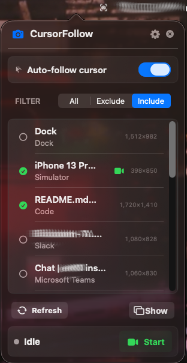
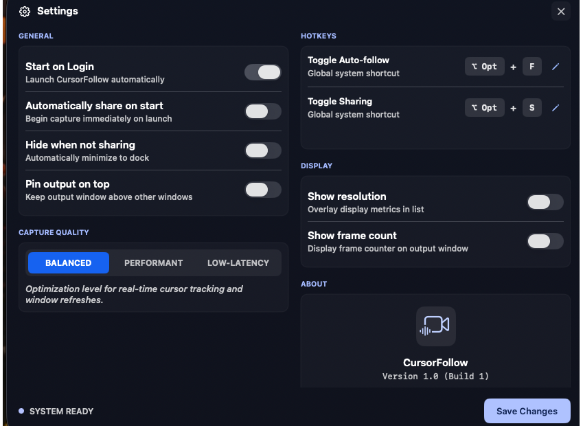

# CursorFollowMac

macOS host app for CursorFollow's shared-window workflow. CursorFollow runs in the menu bar and renders a target window into a stable, shareable window named **CursorFollow Output**.

> New here? See the [project overview](../README.md) for what CursorFollow does and the controls that are common to macOS and Windows.

## Table of Contents

- [Install](#install)
- [Quick Start](#quick-start)
- [Permissions](#permissions)
- [Screenshots](#screenshots)
- [Troubleshooting](#troubleshooting)
    - [Reset checklist](#reset-checklist-when-things-are-stuck)
- [Building & Developing](#building--developing)

---

## Install

1. Download `CursorFollowMac-<version>.dmg` from [GitHub Releases](https://github.com/LoganRupe/CursorFollow/releases/latest).
2. Open the DMG and drag **CursorFollowMac** into **Applications**.
3. Open it once. macOS blocks it, because releases are not notarized by Apple.
4. Go to **System Settings → Privacy & Security**, scroll to the "CursorFollowMac was blocked" message and click **Open Anyway**, then confirm.

You only do this on first install. Updates are signed with the same certificate, so they open normally and keep the Screen Recording permission.

If you prefer the terminal, this clears the download quarantine instead of steps 3 and 4:

```bash
xattr -dr com.apple.quarantine /Applications/CursorFollowMac.app
```

## Quick Start

1. Launch `CursorFollowMac.app`.
2. When prompted, allow **Screen Recording** (required for window capture).
3. Open the CursorFollow menu bar panel.
4. Pick a target window from the list, or set **Target Mode** to **Auto**.
5. Click **Resume** if output is paused.
6. In your meeting app, share the window named **CursorFollow Output**.

See [How It Works](../README.md#how-it-works) for what Target Mode, Filter mode, Output scaling, and Resume/Pause do.

## Permissions

- **Screen Recording**: Required for ScreenCaptureKit window capture.
    - **macOS 13 Ventura / 14 Sonoma / 15 Sequoia**: **System Settings → Privacy & Security → Screen Recording**.

The app is sandboxed (no system-extension or app-group entitlements).

## Screenshots

### Menu bar panel



### Settings window



## Troubleshooting

### Reset checklist (when things are stuck)

1. Quit your video app (Zoom/Meet/Slack/OBS) and quit CursorFollow.
2. In **System Settings → Privacy & Security → Screen Recording**, verify CursorFollow is enabled.
3. Reopen CursorFollow, click **Refresh**, select the target window, then click **Resume**.
4. Reopen your meeting app and reselect **CursorFollow Output** as the shared window.

### CursorFollow Output does not appear in Zoom/Meet/Slack/Teams

- Ensure CursorFollow is running and **CursorFollow Output** is visible.
- Use the meeting app's **Share Screen** or **Share Window** picker, not the camera selector.
- If the picker was already open, close and reopen it after showing the output window.

### Output is black or frozen

- Confirm **Screen Recording** permission is enabled for CursorFollow in System Settings → Privacy & Security → Screen Recording.
- Click **Refresh**, then reselect the target window.
- Pause and resume output from the menu bar panel.

### Wrong window is being captured

- Set **Target Mode** to **Manual** and select a specific window.
- Use **Include** mode to limit capture targets to approved windows.

### Capture feels choppy or high CPU

- In Settings, switch capture quality from **Balanced** to **Performant** or **Low-Latency**.
- Reduce competing screen capture/recording tools running at the same time.
- If needed, capture a smaller target window instead of a full-size display window.

---

## Building & Developing

### Quick Build

From the repository root:

```bash
cd CursorFollowMac
xcodebuild -project CursorFollowMac.xcodeproj -scheme CursorFollowMac -configuration Debug -destination 'platform=macOS,arch=arm64' clean build
```

No Apple developer account is needed. Debug builds are ad-hoc signed ("Sign to Run Locally"), so macOS asks for Screen Recording again after each rebuild.

### Build & Deploy (Stale-Binary Safe)

Xcode incremental builds and macOS binary caching can run stale code. Use this sequence when validating runtime changes.

```bash
cd CursorFollowMac

# 1. Kill any running instance first.
pkill -9 -f CursorFollowMac 2>/dev/null; sleep 1

# 2. Force a clean build.
xcodebuild -scheme CursorFollowMac -configuration Debug -destination 'platform=macOS,arch=arm64' clean build

# 3. Replace existing app bundle.
rm -rf /Applications/CursorFollowMac.app
cp -R ~/Library/Developer/Xcode/DerivedData/CursorFollowMac-*/Build/Products/Debug/CursorFollowMac.app /Applications/CursorFollowMac.app

# 4. Optional: verify binary UUID changed.
dwarfdump --uuid /Applications/CursorFollowMac.app/Contents/MacOS/CursorFollowMac.debug.dylib

# 5. Launch.
open /Applications/CursorFollowMac.app
```

One-liner:

```bash
pkill -9 -f CursorFollowMac 2>/dev/null; sleep 1 && cd CursorFollowMac && xcodebuild -scheme CursorFollowMac -configuration Debug -destination 'platform=macOS,arch=arm64' clean build && rm -rf /Applications/CursorFollowMac.app && cp -R ~/Library/Developer/Xcode/DerivedData/CursorFollowMac-*/Build/Products/Debug/CursorFollowMac.app /Applications/CursorFollowMac.app && open /Applications/CursorFollowMac.app
```

### Signing Identifiers

- Bundle ID: `io.github.loganrupe.CursorFollowMac`
- Release signing identity: `CursorFollow Self-Signed`, a self-signed certificate created by `scripts/make_signing_cert.sh`. No Apple team.

The app is sandboxed (no system-extension or app-group entitlements). The
CoreMediaIO virtual-camera extension was removed — the shipping feature is the
shared-window output, not a virtual camera.

### Project Structure

```text
CursorFollowMac/
├── CursorFollowMac/               # Host app sources
├── CursorFollowMacTests/
├── CursorFollowMacUITests/
├── scripts/                       # Packaging, signing and uninstall tooling
└── CursorFollowMac.xcodeproj/
```

### Packaging & Distribution

Build, sign, package, verify and uninstall scripts live in [scripts/](scripts/).
Run them from the repo root, e.g. `./CursorFollowMac/scripts/package.sh`. See
[Docs/Distribution/Packaging.md](../Docs/Distribution/Packaging.md) for the full
workflow.
