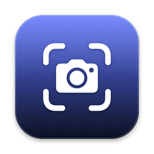

  

# CursorFollow

Capture a target window and render it into a stable, shareable window named **CursorFollow Output**. Share that one window from Zoom, Google Meet, Slack, Teams, OBS, or any app with a window-share picker — and it keeps following your target as you switch focus, so your audience always sees the right thing without you re-picking a share source.

CursorFollow ships for **macOS**, **Windows**, and **Linux (Hyprland)**. This page covers what's common to all of them; each platform's page has the setup, permissions, screenshots, and troubleshooting specific to that OS.

## Table of Contents

- [Overview](#overview)
- [Platforms](#platforms)
- [How It Works](#how-it-works)
- [Download & Install](#download--install)
- [Troubleshooting](#troubleshooting)
- [Developer Docs](#developer-docs)
- [License](#license)

## Overview

CursorFollow runs in the background — the **menu bar** on macOS, the **system tray** on Windows, a small control panel on Linux — and keeps **CursorFollow Output** pointed at the window you want to share. It can follow the frontmost eligible window automatically, or lock to a specific window manually. Because the thing you share is an ordinary app window, you keep your real webcam selected and simply add the output window as a screen/window share.

## Platforms

| Platform | Capture | Surface | Status | Docs |
| -------- | ------- | ------- | ------ | ---- |
| **macOS** | ScreenCaptureKit | Menu bar app + shared output window | Mature | [CursorFollowMac/README.md](CursorFollowMac/README.md) |
| **Windows** | Windows Graphics Capture | Tray app + shared output window | Output-window-first port | [CursorFollowWin/README.md](CursorFollowWin/README.md) |
| **Linux** | Hyprland toplevel export (Wayland) | GTK 4 control panel + shared output window | First working build, Hyprland only | [CursorFollowLinux/README.md](CursorFollowLinux/README.md) |

All platforms render to the same **CursorFollow Output** window. The shared output window is the shipping feature on each — a virtual-camera mode is **not** part of the product.

## How It Works

These controls behave the same on both platforms (only the UI placement differs):

- **Target Mode** — **Auto** tracks the active eligible window; **Manual** keeps the selected target.
- **Filter mode** — **All / Exclude / Include** controls which windows appear as capture targets.
- **Output scaling** — **Fit**, **Fill**, or **Actual** for the shared output window.
- **Refresh** — re-scan active windows if the list looks stale or incomplete.
- **Show / Hide** — bring the persistent output window forward or hide it.
- **Resume / Pause** — start or pause output without changing the shared window's identity.

## Download & Install

Download the latest build from **[GitHub Releases](https://github.com/LoganRupe/CursorFollow/releases/latest)**, then install for your platform:

- **macOS** — open the `.dmg` and drag **CursorFollowMac** into **Applications**. Releases are not notarized, so approve the first launch in **System Settings → Privacy & Security → Open Anyway**, then grant **Screen Recording** when prompted. See [macOS install](CursorFollowMac/README.md#install).
- **Windows** — run the `.msi` (no admin required). See [Windows setup](CursorFollowWin/README.md#installer).
- **Linux** — no packaged build yet; build from source with `make` and `make install`. See [Linux build](CursorFollowLinux/README.md#build-test-run).

Then point your meeting app's **window** picker at **CursorFollow Output**: pick a target window (or set **Target Mode** to **Auto**), make sure output isn't paused, and share it.

> Prefer to build it yourself? See [Developer Docs](#developer-docs).

## Troubleshooting

The general reset is the same everywhere — quit your meeting app and CursorFollow, confirm capture permission, reopen CursorFollow, **Refresh**, reselect the target, **Resume**, then reselect **CursorFollow Output** in the meeting app. For platform specifics (permission paths, black/frozen output, picker quirks):

- **macOS** — [Troubleshooting](CursorFollowMac/README.md#troubleshooting)
- **Windows** — [Troubleshooting](CursorFollowWin/docs/Troubleshooting.md)
- **Linux** — [Troubleshooting](CursorFollowLinux/README.md#troubleshooting)

## Developer Docs

### Build from source

- **macOS app** — build, signing, packaging: [CursorFollowMac/README.md](CursorFollowMac/README.md#building--developing)
- **Windows app** — build, publish, installer: [CursorFollowWin/README.md](CursorFollowWin/README.md#build)
- **Linux app** — build, test, install: [CursorFollowLinux/README.md](CursorFollowLinux/README.md#build-test-run)
- **macOS packaging & signing** — [Docs/Distribution/Packaging.md](Docs/Distribution/Packaging.md)
- **Working with AI coding agents** — [AGENTS.md](AGENTS.md)

### Releasing

Releases are published manually to [GitHub Releases](https://github.com/LoganRupe/CursorFollow/releases). For each version:

1. **macOS** — run `./CursorFollowMac/scripts/package.sh` to produce a self-signed `CursorFollowMac-<version>.dmg` (details in [Docs/Distribution/Packaging.md](Docs/Distribution/Packaging.md)).
2. **Windows** — build the `.msi` (see [Windows build](CursorFollowWin/README.md#build)).
3. Create a new GitHub release, tag the version (e.g. `v1.0`), and upload both the `.dmg` and `.msi` as release assets.

## License

CursorFollow is released under the [MIT License](LICENSE).
